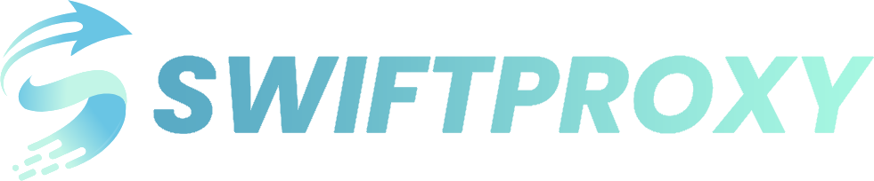

<div align="center">

[English](./README.md) | 简体中文


# AgentDock MCP

**让 AI 的双手，真正触达你的每一台设备。**

打开网页版 ChatGPT，即可管理多台电脑与服务器：在真实设备上写代码、改配置、跑命令与部署，执行发生在你的机器上，不消耗Codex额度。

<a href="https://trendshift.io/repositories/136526?utm_source=trendshift-badge&amp;utm_medium=badge&amp;utm_campaign=badge-trendshift-136526" target="_blank" rel="noopener noreferrer"></a>

[在线文档](https://docs.nexusdock.co/agentdock/) · [下载安装](https://www.nexusdock.co/download/) · [QQ群](https://qun.qq.com/universal-share/share?ac=1&authKey=Rp86bSzI7vqm87KoYlKawgsPZ440Ubhyezw6Qkgcn3JISwX3zXxsXkbS5598RrY5&busi_data=eyJncm91cENvZGUiOiIxMDgxMzM3MDE5IiwidG9rZW4iOiJ0Mlg1bUU1ZWtuZzF3SHJDT3pSaGsrOURIMlNYaXBlYllOUjNLZ1BUb1hzM2lJSTZjeVNldzU0ajl0SjRVZkx2IiwidWluIjoiMzIwMjA4ODAzMiJ9&data=W28mWvuqaLf_Fwnf0CgAJXuDs6l3A78V7AoWZnizPboCpKoQMzHzZ-UlluYo47U3tmIBHK2xIgWEVEJbTiGsPQ&svctype=4&tempid=h5_group_info)

[](https://github.com/uvwt/agentdock/actions/workflows/ci.yml)
[](https://github.com/uvwt/agentdock/releases)
[](https://hub.docker.com/r/agentdockio/agentdock)
[](https://github.com/uvwt/agentdock/pkgs/container/agentdock)
[](./LICENSE)

</div>

<p align="center">
  
</p>

## AgentDock 是什么

AgentDock 是一个面向 AI Agent 的独立工具运行层。

它为本地电脑、远程服务器与容器环境提供统一、安全、可控的文件、命令、Git、Skill、MCP、浏览器自动化和任务执行能力。配置多台 AgentDock，还能跨设备协同，把原本要在多机之间来回切换的工作，收敛到一次对话里完成。

AgentDock 不提供聊天界面，也不负责模型推理。它专注于解决一件事：

> 让 AI Agent 在明确的权限边界内操作真实环境，并返回结构化、可追踪、可验证的执行结果。

```text
              ChatGPT / Claude / Codex
                        │
                        │ MCP（可接入多台）
          ┌─────────────┼─────────────┐
          ▼             ▼             ▼
   ┌───────────┐ ┌───────────┐ ┌───────────┐
   │ AgentDock │ │ AgentDock │ │ AgentDock │
   │  本机电脑  │ │  内网机器   │ │  云服务器  │
   └─────┬─────┘ └─────┬─────┘ └─────┬─────┘
         │             │             │
         ▼             ▼             ▼
   文件·命令·Git  穿透客户端等   转发·反代·部署
```

## 你可以用 AgentDock 做什么

- 用网页版 ChatGPT 直接管理多台电脑与服务器，无需分别 SSH 登录来回操作
- 在真实设备上写代码、改项目、跑测试并操作 Git，执行发生在本机或服务器，不依赖专用编程 Agent 额度
- 让 AI 管理 VPS、Docker 服务、反向代理和部署配置
- 让 AI 检查日志、进程、端口和真实运行状态
- 让 AI 操作登录后的网页与 macOS 桌面应用
- 配置多台 AgentDock，在一次对话中完成跨设备协同任务
- 通过 Skill 和动态 MCP 扩展外部能力
- 保存长时间任务的执行状态，并在中断后继续
- 用同一套工具模型连接 macOS、Linux、Windows 与容器环境
- 等等


## 快速开始

普通用户直接使用正式安装包即可，不需要下载源码、安装 Go 或自己构建 AgentDock。

完整步骤见 [安装 AgentDock](https://uvwt.github.io/agentdock-docs/zh-CN/docs/getting-started/install)。


| 平台 | 文档 |
| --- | --- |
| Docker | [Docker 快速部署](https://uvwt.github.io/agentdock-docs/zh-CN/docs/getting-started/docker) |
| Linux | [Linux 自动安装](https://uvwt.github.io/agentdock-docs/zh-CN/docs/getting-started/linux) |
| Linux / VPS | [systemd 部署](https://uvwt.github.io/agentdock-docs/zh-CN/docs/getting-started/vps) |
| macOS | [macOS 安装](https://uvwt.github.io/agentdock-docs/zh-CN/docs/getting-started/macos) |
| Windows | [Windows 图形安装程序](https://uvwt.github.io/agentdock-docs/zh-CN/docs/getting-started/windows) |


### 连接方式如何选择

- **仅本机**：客户端和 AgentDock 在同一台电脑上。
- **临时公网地址**：没有域名，但需要从 ChatGPT、手机或其他设备连接。地址可能在 Tunnel 重启后变化。
- **固定域名**：长期使用稳定公网地址，需要已接入 Cloudflare 的域名和 Tunnel Token。

安装完成后，从控制面板或终端取得 MCP 地址，以及 Bearer Token 或 OAuth 登录信息，再填入客户端的 MCP、Tools 或 Connectors 设置。公网访问必须保留认证，不要把凭据放进截图、Issue 或公开聊天。

## 接入 AI 客户端

AgentDock 通过 MCP Streamable HTTP 提供工具能力。下面是一个通用配置示例，具体字段格式取决于所使用的 AI 客户端：

```json
{
  "mcpServers": {
    "agentdock": {
      "url": "http://127.0.0.1:8765/mcp",
      "headers": {
        "Authorization": "Bearer <AGENTDOCK_AUTH_TOKEN>"
      }
    }
  }
}
```


## 核心能力

- **文件与命令**：在设备上读写文件、搜索代码、执行命令。
- **多设备管理**：连接本机、服务器和容器，跨设备完成任务；可搭配 NexusDock 统一接入并保存项目记忆。
- **浏览器与桌面**：操作网页、复用登录状态、截图，以及控制 macOS 桌面应用。
- **能力扩展**：通过 Skills 和 MCP 接入更多工具，官方与社区 Skills 见 [agentdock-skills](https://github.com/uvwt/agentdock-skills)。
- **编程助手**：连接 Codex、Claude 等受支持的编程助手，在设备上开发项目。
- **任务恢复**：保存进度和检查点，让长时间任务在中断后继续执行。

配置与使用详情见[在线文档](https://docs.nexusdock.co/agentdock/)。

## 运行目录

| 路径 | 用途 |
| --- | --- |
| `~/AgentDock` | 相对文件操作的默认工作目录 |
| `~/.agentdock` | AgentDock 状态、配置、会话和扩展数据 |

## 感谢赞助商

| <div align="center"><strong>🏆 赞助商 🏆</strong></div> | <div align="center"><strong>介绍</strong></div> |
| :------------- | :------ |
| <a href="https://www.swiftproxy.net/?ref=agentdock"></a> | <br>[**Swiftproxy**](https://www.swiftproxy.net/?ref=agentdock)<br>提供高质量动态和静态住宅代理，拥有 9000 万+住宅 IP，覆盖全球 220+ 个地区，支持 HTTP(S)、SOCKS5、IP 轮换与粘性会话，为 AI Agent、浏览器自动化和网页数据采集提供灵活的代理支持。动态住宅代理低至 $0.7/GB，使用优惠码 <code>PROXY90</code> 享受九折优惠。 |

想支持项目或展示品牌？[联系维护者](mailto:t80980@gmail.com)。

## 支持项目

<p>如果 <b>AgentDock</b> 对您有帮助，请考虑为它点个 <b>Star</b> ⭐，感谢您的支持</p>

| 微信赞赏 | 支付宝 | Buy Me a Coffee |
| :---: | :---: | :---: |
| <a href="./docs/assets/donation/wechat-qr.png"></a> | <a href="./docs/assets/donation/alipay-qr.png"></a> | <a href="https://buymeacoffee.com/uvwt"></a> |

## Star 趋势

[](https://star-history.com/#uvwt/agentdock&Date)

## 相关链接

- [Documentation](https://docs.nexusdock.co/agentdock/)
- [Documentation source](https://github.com/uvwt/agentdock-docs)
- [GitHub Releases](https://github.com/uvwt/agentdock/releases)
- [GitHub Container Registry](https://github.com/uvwt/agentdock/pkgs/container/agentdock)
- [Docker Hub](https://hub.docker.com/r/agentdockio/agentdock)
- [Linux Do](https://linux.do/)

## License

Apache License 2.0. See [LICENSE](./LICENSE).

## 交流反馈

[加入 QQ 群（1081337019）](https://qun.qq.com/universal-share/share?ac=1&authKey=Rp86bSzI7vqm87KoYlKawgsPZ440Ubhyezw6Qkgcn3JISwX3zXxsXkbS5598RrY5&busi_data=eyJncm91cENvZGUiOiIxMDgxMzM3MDE5IiwidG9rZW4iOiJ0Mlg1bUU1ZWtuZzF3SHJDT3pSaGsrOURIMlNYaXBlYllOUjNLZ1BUb1hzM2lJSTZjeVNldzU0ajl0SjRVZkx2IiwidWluIjoiMzIwMjA4ODAzMiJ9&data=W28mWvuqaLf_Fwnf0CgAJXuDs6l3A78V7AoWZnizPboCpKoQMzHzZ-UlluYo47U3tmIBHK2xIgWEVEJbTiGsPQ&svctype=4&tempid=h5_group_info)
